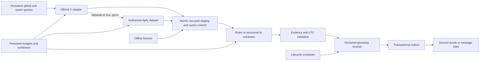

# Architecture

`config.py` validates configuration and live-provider prerequisites. `models.py` defines normalized posts and typed claims. `providers.py` implements the interchangeable async Source protocol, HTTP errors/cooldowns and pre-request reservations. `extraction.py` implements conservative rules and strict AI extraction. `storage.py` owns SQLite transactions and schema version 1. `service.py` runs polling, extraction and lifecycle refresh serially. `discord_bot.py` owns commands and delivery. `cli.py` owns process locking, resource cleanup and execution modes.

Raw pages and pagination progress are one SQLite transaction. Extraction is separately retryable, so an AI outage does not lose fetched posts. Every changed post is reprocessed; unchanged content does not cost another extraction. Giveaway writes and outbox jobs are one transaction. Outbox entries coalesce to the latest revision. Delivery acknowledgements are revision-checked so they cannot delete a newer pending update.

Queries have a fixed start/end window across pages, per-query next-run time and persistent cursor. Each tick fetches at most one page per selected query. Global gets one slot; remaining queries use oldest-due-first scheduling, with priority as a tie-breaker and shorter polling intervals for high-priority accounts. This prevents low-priority accounts from being permanently starved. Very large watchlists may exceed the configured API budget; expose that backlog instead of pretending full coverage.

No post content is executed. AI has no tools. URLs are displayed but not fetched. Evidence validation checks exact quote presence and explicit timestamp equivalence; it cannot prove a model's semantic reading is correct. Source text itself may be fraudulent. Sponsor website attribution remains a claim from the original post.

Database tables: posts (raw content/retry state), giveaways (normalized record/revision), queries (watchlist and cursors), budgets (UTC counters), subscriptions, deliveries (saved message IDs), outbox (pending edits/sends), and meta (schema, cooldowns and heartbeat).

Growth path: audited retention/deletion handling, explicit campaign/update linkage, richer deterministic date parsing, extraction evals from labelled real posts, multi-server tenant boundaries, provider billing reconciliation, and PostgreSQL plus leased jobs before horizontal scaling.

X coverage checkpoints are keyed by source, search mode and query text. The final raw page, cleared cursor and coverage checkpoint commit atomically. Initial and periodic deep scans revisit the configured window; interrupted pages retain their original time bounds. Recent-search backlog expiry records a visible coverage warning. Outbox jobs for newly discovered terminal giveaways are suppressed, while existing cards can still receive terminal edits.
